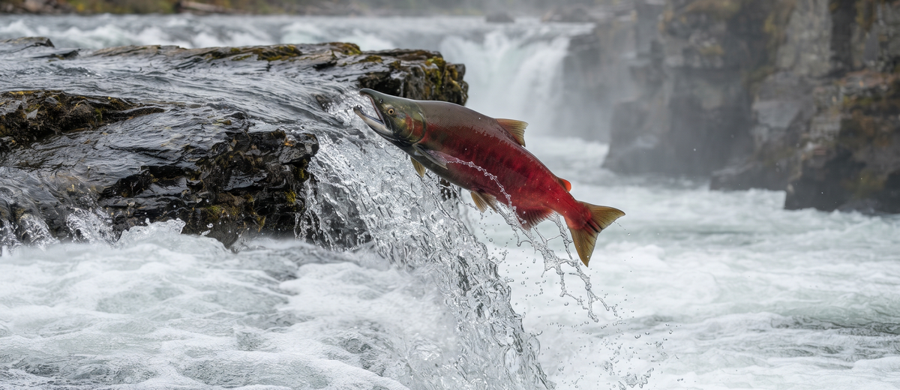
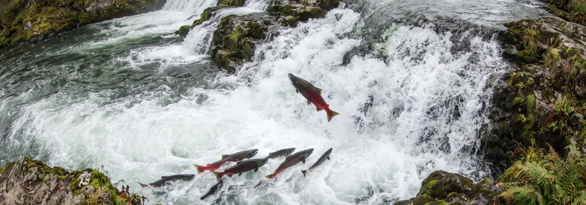
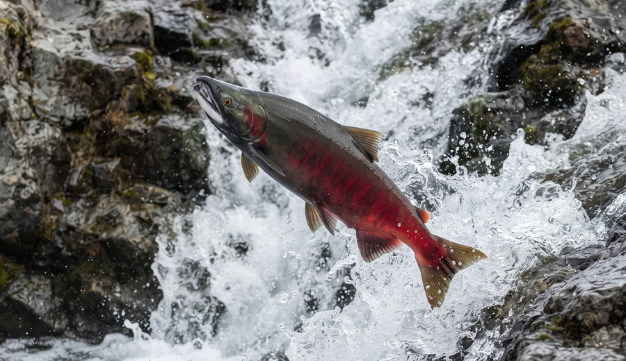
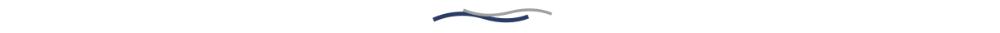

# analyze-reverse-shell-detector

# analyze-reverse-shell-detector
Detects reverse shell connections by analyzing network traffic patterns and established connections, flagging suspicious shell-like activity based on communication frequency and data transfer characteristics. Each connection group is scored two ways: an absolute score from its total bytes alone (total_bytes / (total_bytes + 100000000)), and a relative normalized score computed within the input file. A group is flagged when its absolute score exceeds the threshold (default 0.8), or when its relative score exceeds the threshold and its total bytes reach the minimum bytes value (default 1000000, set with --min-bytes). The relative score alone never flags a group below that minimum, and a single large group can be flagged on its absolute score. - Focused on Data analysis and reporting

> Cave pocket: the relative score alone never flags a group below the minimum bytes value, default 1000000, set with --min-bytes. A single large group can still be flagged on its absolute score.

## Install
`git clone https://github.com/ShadowGuardAI/analyze-reverse-shell-detector`

> Cave pocket: the clone address above spells the account ShadowGuardAI with no hyphen, whereas the repository home is ShadowGuard-AI. The line is preserved as written, so correct it by hand if you copy it.

## Usage
`./analyze-reverse-shell-detector [params]`

## Parameters
- `-h`: Show help message and exit
- `-i`: Path to the network traffic data file (e.g., CSV, PCAP converted to CSV).
- `-o`: Path to save the analysis report. Defaults to reverse_shell_report.txt
- `-t`: Threshold for flagging suspicious connections. Defaults to 0.8.
- `--min-bytes`: Minimum total bytes a connection group must reach before the relative score alone can flag it. Defaults to 1000000.
- `-f`: Format of the input file. Only 'csv' is supported. Defaults to 'csv'.

## License
Copyright (c) ShadowGuardAI
